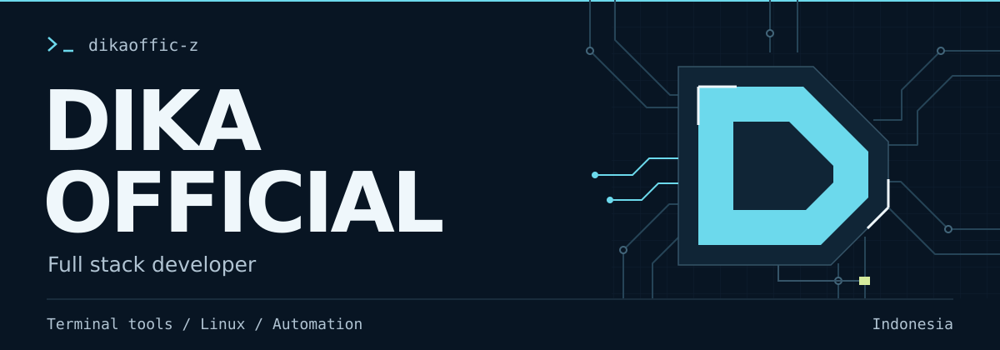

<picture>
  <source media="(max-width: 640px)" srcset="./assets/header-mobile.svg">
  
</picture>

I'm Dika, a full stack developer from Indonesia. I build terminal tools, explore Linux environments, and automate the repetitive parts.

## Selected projects

- **[onetools-agent](https://github.com/dikaoffic-z/onetools-agent)** — A Rust terminal coding agent with a REPL, a TUI, and MCP integrations.
- **[DPassGen](https://github.com/dikaoffic-z/DPassGen)** — A Python CLI for generating passwords and passphrases, checking password strength, and computing hashes.
- **[kali-termux](https://github.com/dikaoffic-z/kali-termux)** — A Bash installer for setting up Kali Linux, tools, and optional VNC access in Termux.

[Browse all repositories](https://github.com/dikaoffic-z?tab=repositories)

## Stack

- **Languages:** Rust, Python, Bash, JavaScript, TypeScript, HTML, CSS
- **Web:** React, Next.js, Node.js, Tailwind CSS
- **Environment:** Linux, Termux, Git

## Connect

[WhatsApp](https://wa.me/6287864340600) &nbsp; / &nbsp; [Instagram](https://instagram.com/dikadamzz) &nbsp; / &nbsp; [TikTok](https://tiktok.com/@dwikaakbar.xyz)
